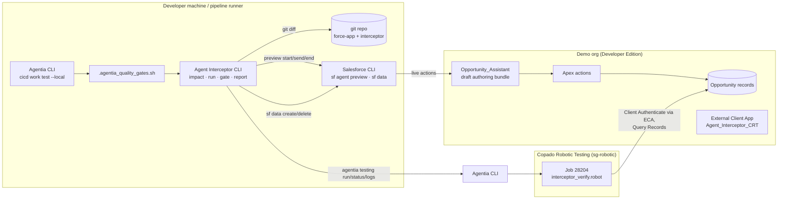
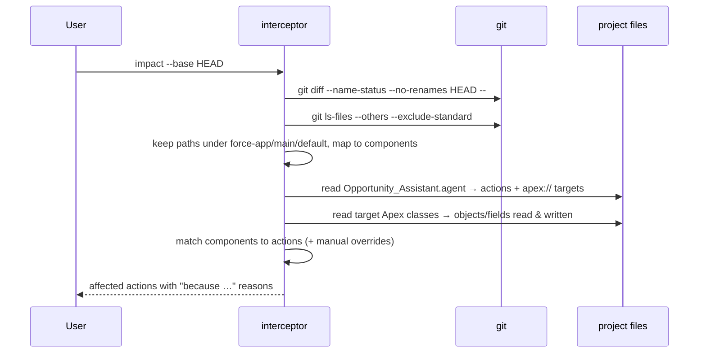
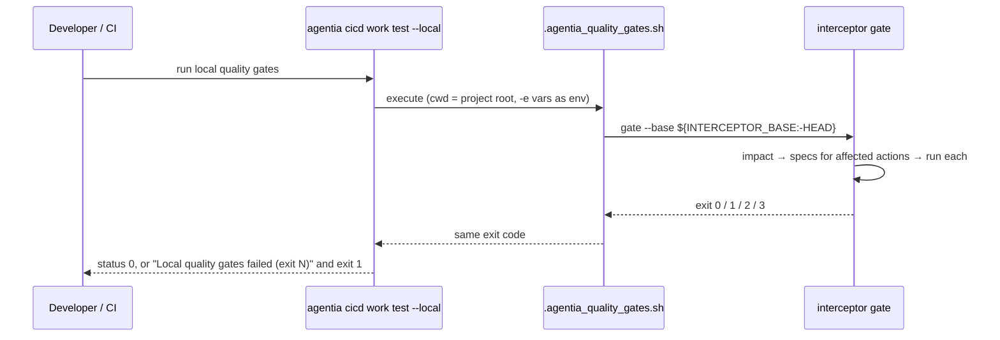

# Agent Interceptor: Low-Level Design

Status as of 2026-10-19. Every external command, flag, keyword and JSON shape referred to here was checked and is recorded in [VERIFICATION_LOG.md](VERIFICATION_LOG.md). Where something is assumed or untested, this document says so.

## Contents

1. [Summary](#1-summary)
2. [Context and problem](#2-context-and-problem)
3. [Verified vs assumed](#3-verified-vs-assumed)
4. [Demo org and agent](#4-demo-org-and-agent)
5. [Architecture](#5-architecture)
6. [End-to-end sequence diagrams](#6-end-to-end-sequence-diagrams)
7. [Module-by-module design](#7-module-by-module-design)
8. [Data models](#8-data-models)
9. [CRT integration](#9-crt-integration)
10. [Conversation channel](#10-conversation-channel)
11. [Claim classification and verdict logic](#11-claim-classification-and-verdict-logic)
12. [Impact analysis](#12-impact-analysis)
13. [Pipeline integration](#13-pipeline-integration)
14. [Security and safety](#14-security-and-safety)
15. [CLI and configuration reference](#15-cli-and-configuration-reference)
16. [Testing](#16-testing)
17. [Limitations and future work](#17-limitations-and-future-work)
18. [Runbook](#18-runbook)
19. [Demo script](#19-demo-script)
20. [Decision log](#20-decision-log)
21. [Glossary](#21-glossary)

---

## 1. Summary

**What it does.**

1. Agent Interceptor reads a change (a git diff of Salesforce metadata) and works out which Agentforce agent actions the change can affect, giving the reason for each.
2. For every affected action it runs an interception test: it creates its own `AI-Test-<runId>` records, then asks the agent (with **live** actions, in the non-production demo org) to do the job.
3. It ignores the agent's wording when deciding pass or fail. It checks the org's records afterwards in **Copado Robotic Testing (CRT)**, which Agentia Headless starts from the terminal.
4. It combines what the agent claimed, which action the session trace shows, and what the org holds into one verdict per action (`VERIFIED`, `FALSE_SUCCESS`, `HONEST_FAILURE`, `WRONG_ACTION`, `UNEXPECTED_CHANGE`, `INCONCLUSIVE`), with a plain-language explanation and the evidence.
5. `interceptor gate` turns the verdicts into an exit code. Agentia's local quality gate (`agentia cicd work test --local`, run before `cicd work submit`) calls it, so an intercepted change is blocked before promotion.

**What it does not do.**

- It does not fix agents or apply changes. The planned fix loop (handing evidence to Agentia's AI) is not built (§17).
- It does not test production; a guard refuses any org except the configured Developer Edition org.
- It does not prove the absence of every bug. It checks the specific outcomes written in its specs, for the actions its impact analysis selects. Impact analysis is heuristic (§12).
- It does not run conversations through the Agent API or CRT. Conversations go through `sf agent preview`; CRT checks the records.
- It has not caught a live `FALSE_SUCCESS`. The demo agent reports failures honestly, so the live demo shows `HONEST_FAILURE` (§4, §20 D8).

## 2. Context and problem

An Agentforce agent answers in natural language. When it says "Done, the opportunity is now Closed Won", that sentence comes from a language model that was given the action's output. Three things can make the sentence untrue, or the release unsafe, while a reply-only test still passes:

- **The save failed**, because a validation rule, Flow error, trigger, missing permission or record lock blocked it, and the agent (or a badly written action) still says it worked.
- **The wrong action ran**, or no action ran, and the model wrote a plausible confirmation anyway.
- **Something else changed**: the right record changed, but so did one that should not have.

A test that only compares the reply with an expected sentence ("contains 'Closed Won'") cannot see any of this. Agent Interceptor treats the reply as a **claim** and checks the **org** for the outcome.

**Concrete demo example.** The Opportunity Assistant agent can move an opportunity to a new stage. A developer adds a validation rule, "Closed Won needs an approved quote first", that blocks every move to Closed Won. Nobody changed the agent, so a team with reply-only tests would not even re-test it. Agent Interceptor sees the new rule in the diff, maps it to `update_opportunity_stage` (rules run on save; the action saves Opportunity), and asks the agent to close an `AI-Test` opportunity. The agent says, honestly, "The change was not saved: Closed Won needs an approved quote first." CRT confirms the record is still in Negotiation/Review. The verdict is `HONEST_FAILURE`, the gate exits 1, and Agentia's quality gate fails. After the rule is fixed (only deals of 50,000 or more need a quote), the same gate returns `VERIFIED` and exit 0. This ran end to end on 2026-10-19 (§16).

Simulation shows why reply-only checks mislead. In **simulated** preview, where the platform's LLM invents action outputs, the agent told us "The opportunity "AI-Test-sim4" stage is now Signed", a stage that does not exist. The reply looks like a success; the org would show otherwise.

## 3. Verified vs assumed

"Verified" means the command was run on this machine against the demo org or CRT, and its output was read. Evidence lives in [VERIFICATION_LOG.md](VERIFICATION_LOG.md) under the named section.

| Dependency | Used for | Status | Evidence (VERIFICATION_LOG section) |
|---|---|---|---|
| `sf` CLI 2.152.14, `@salesforce/plugin-agent` 2.2.2 | everything Salesforce | verified | Phase 0 check 1 |
| `sf org display --json`, `sf data query --json` on `Organization` | production guard | verified | Phase 0 check 2 |
| `sf data create/update/delete record --json` | test data | verified | Phase 0 check 4; Phase 1 live preview |
| `sf agent preview start --authoring-bundle … --use-live-actions/--simulate-actions --json` | conversation | verified, **needs a workaround** (`access.default_agent_user`) | Phase 1 simulated preview |
| `sf agent preview send … -u … --json` → `result.messages[].{message, planId}` | replies, planId | verified | Phase 1 live preview |
| `sf agent preview end --json` → trace path | session end | verified | Phase 1 |
| Raw trace `.sfdx/agents/<bundle>/sessions/<sid>/traces/<planId>.json`, `.plan[]` FunctionStep `.function.{name,input,output}` | which action ran | verified (format observed, not a documented contract) | Phase 1 live preview, "Trace facts" |
| `sf agent trace read -t N` | **not used**: its numbering counts every message | verified defect | Phase 1 live preview |
| `sf agent validate authoring-bundle --json` | agent build | verified | Phase 1 build |
| `sf project deploy start/validate --json`, `--metadata-dir` (no `--single-package`) | deploys, demo rule | verified | Phase 1 deploy; Phase 1 live preview |
| Agentia CLI `@copado/agentia-cli` 1.0.0-rc.0 | CRT orchestration, quality gate | verified | Phase 0 check 1b |
| `agentia auth get --crt --json` → `ready: true` | CRT readiness | verified | Phase 0 check 3 |
| `agentia testing create / update / run / status / logs --json` | CRT job and runs | verified | Phase 0 checks 3–5; Phase 2 |
| `agentia testing run … --variable NAME:value` → Robot `-v` | passing run data | verified | Phase 0 check 5 |
| `agentia testing variable create/update/list … --sensitive --value-stdin` | CRT secrets | verified | Phase 0 check 4 |
| `agentia cicd work test --local` runs `.agentia_quality_gates.sh` | pipeline gate | verified (exit 0/1 behaviour) | Phase 2 Agentia quality-gate integration |
| `agentia cicd work submit` | promotion with gates | **not run** (needs CICD auth, pipeline, user story) | — |
| `agentia cicd metadata dependency list` | Agentia dependency analysis | help read only; **not run** (needs CICD pipeline) | Phase 0 check 1b |
| `agentia ai agent ask` | fix loop | help read only; **not run** (no AI auth) | Phase 0 check 1b |
| QForce `Client Authenticate`, `Query Records` | CRT org checks | verified | Phase 0 check 4; Phase 2 CRT job |
| QForce `Create Agentforce Session`, `Send Agentforce Message` | (alternative channel) | exist (libdoc); **not used** | Phase 0 check 5 |
| Agentia MCP server (`agentia mcp start`): `agentia_testing_build_get` | AI agent confirms the CRT result (Agent Skill) | verified over JSON-RPC; `agentia_work_test` over MCP runs the gate script but returns an error without a Copado work item; logs come back redacted | Agentia MCP server + Agent Skill |
| Claude Code loading `.claude/skills/agent-interceptor` and calling the MCP tool | explain a block in plain language | **not yet verified end to end** | Agentia MCP server + Agent Skill |
| External Client App metadata (client credentials) | CRT login | verified (deployed, token works) | Phase 0 check 4 |

**Assumed / not verified:**

- That `agentia testing status --job <id> --json` returns enough recent builds to find the current run by `RUN_ID`. It did in every run so far, but paging was not tested.
- That trace file structure stays stable across CLI releases (it's an observed format).
- That the client-credentials run-as user works without "API Only". It did here, against the metadata reference's wording.
- Whether live preview actions run as the CLI's logged-in user or as `default_agent_user`: in this org both are the same admin, so it cannot be told apart (§10).

## 4. Demo org and agent

**Org.** Developer Edition, org ID `YOUR_ORG_ID`, My Domain `YOUR_MY_DOMAIN`, instance USA1336, API 68.0, CLI alias `interceptor-dev`. Agent Platform enabled (`AgentPlatformSettings.enableAgentPlatform = true`); you confirmed Agentforce is on in Setup. Ten standard Opportunity stages, no Opportunity record types, and no Opportunities or Opportunity validation rules except during runs.

**Agent.** `Opportunity_Assistant`, an employee agent (`AgentforceEmployeeAgent`) written in Agent Script and kept as a **draft authoring bundle** (never published). Design and approval: [agent/Opportunity_Assistant-AgentSpec.md](agent/Opportunity_Assistant-AgentSpec.md).

- One `start_agent` block, no subagents.
- One variable, `selected_opportunity_id`. `find_opportunity` sets it from its output: the record ID when exactly one record matched, empty otherwise. `update_opportunity_stage` takes its ID input from the variable and is only available when the variable is non-empty (`available when @variables.selected_opportunity_id != ""`). This enforces "find before update" and stops the model inventing an ID.
- Instructions: report only what the action returned; never say a change was made unless `success = True`.

**Actions** (invocable Apex, `with sharing`, user-mode queries and DML, bulk-safe):

| Action | Apex class | Inputs | Outputs |
|---|---|---|---|
| `find_opportunity` | `OpportunityAssistantFind` | `opportunityName` | `matchCount`, `opportunityId` (hidden from the model), `opportunityName`, `stageName`, `closeDate`, `amount`, `candidates`, `message` |
| `update_opportunity_stage` | `OpportunityAssistantUpdateStage` | `opportunityId` (bound to the variable), `newStage` | `success`, `message`, `currentStage`, `previousStage` |

`update_opportunity_stage` checks the stage against active picklist values, saves with `Database.update(records, false, AccessLevel.USER_MODE)`, puts any save error text into `message`, and sets `success` only if a re-query shows the new stage. It reports failures truthfully by design; nothing was built to make it lie.

**Permissions.** `Opportunity_Assistant_Access` (Apex class access for both classes; Opportunity read/edit; Amount read) is assigned to the admin user. `agentAccesses` is not included because the agent is not published.

**Apex tests.** 16 tests; coverage 100% (`Find`) and 91.4% (`UpdateStage`). The save-error path is covered by a real failure: a Read Only user who owns the record cannot edit it.

**Observed behaviour in live preview** (2026-10-19, exact replies in VERIFICATION_LOG "Phase 1: live preview"):

| Case | What happened in the org | What the agent said (start) |
|---|---|---|
| Happy path | Prospecting → Qualification | "… is now Qualification." |
| Not found | nothing | "No opportunity matched "…". Please check the name …" |
| Ambiguous (2 matches) | nothing on turn 1; after the user picked one, only that one changed | lists both, "Which one do you want to update to Closed Won?" |
| Invalid stage "Signed" | nothing | "The change was not saved. Stage "Signed" isn't valid. Valid stages are: …" |
| Blocked save (validation rule) | nothing | "The change was not saved: Closed Won needs an approved quote first. The stage is still Negotiation/Review." |

## 5. Architecture



**Channels and why they were chosen.**

| Need | Chosen | Rejected and why |
|---|---|---|
| Talk to the agent | `sf agent preview` with `--use-live-actions` on the **draft** authoring bundle | Agent API / QForce `Create Agentforce Session`: needs a **published, activated** agent and more OAuth scopes. Publishing is a release step we avoid, and the skill warns publish may fail with the `default_agent_user` workaround. |
| Check the org | CRT job running a generic Robot suite (QForce `Query Records`), started by `agentia testing run` | Local `sf data query`: kept as a dev-loop verifier (`--verifier local`), always labelled "not CRT". |
| Pass run data to CRT | `--variable CHECKS_B64:<base64 JSON>` | Data tables (can't combine with some flags per research; more state); uploading a file per run (slower, leaves history). |
| CRT login to the org | Client credentials via an External Client App | Username-password `Authenticate`: deprecated in QForce. JWT: more moving parts (key pair). |
| Which actions a change affects | Own analysis: git diff → `.agent` → Apex footprint | `agentia cicd metadata dependency list`: needs a Copado pipeline and credentials, and it is unknown whether it understands Agentforce actions. |
| Block promotion | `.agentia_quality_gates.sh` → `interceptor gate` | Remote Copado quality gates: Agentia says `--cloud` is "not implemented yet". |

## 6. End-to-end sequence diagrams

### `interceptor impact`



### `interceptor run` (one spec)

```mermaid
sequenceDiagram
  participant I as interceptor
  participant SF as sf CLI
  participant A as Agent (preview, live actions)
  participant AG as agentia
  participant C as CRT job
  I->>SF: org display + Organization query (production guard)
  I->>SF: data create record ×N (Name = AI-Test-<runId>-…)
  I->>SF: data query (baseline of checked fields)
  I->>SF: agent preview start --use-live-actions
  loop each utterance
    I->>SF: agent preview send -u "…"
    SF->>A: utterance
    A-->>SF: reply + planId
    I->>I: read traces/<planId>.json → actions run
  end
  I->>SF: agent preview end
  I->>I: classify the last reply (claim)
  I->>AG: testing run <job> --wait-for-result --variable SF_DOMAIN/RUN_ID/CHECKS_B64
  AG->>C: start build
  C->>C: Client Authenticate; Query Records per check; IVERIFY lines
  AG-->>I: exit code (no build ID on failure)
  I->>AG: testing status --job → build whose RUN_ID matches
  I->>AG: testing logs <build> → IVERIFY lines
  I->>I: verdict (decision table)
  I->>SF: data delete record ×N (unless --keep-data)
  I->>I: write runs/<runId>/run.json + report.md
```

### `gate` in a pipeline



### Fix loop (designed, not built)

```mermaid
sequenceDiagram
  participant Dev as Developer
  participant I as interceptor
  participant AI as agentia ai agent ask (not built)
  Dev->>I: gate → exit 1 (HONEST_FAILURE)
  Dev->>I: explain <runId>
  Note over I,AI: Planned: interceptor fix <runId> sends the verdict, reply,<br/>trace and org evidence to agentia ai agent ask; never auto-applies.
  Dev->>Dev: change the metadata (e.g. narrow the validation rule)
  Dev->>I: gate → exit 0 (VERIFIED)
```

In the demo the fix is done by hand (rule v2).

## 7. Module-by-module design

All source is in `interceptor/src` (about 2,000 lines of TypeScript). Every external call goes through the `Runner` interface (`util/exec.ts`), so tests replace it with recorded output.

### `util/exec.ts`
- **Responsibility:** spawn commands **without a shell** (arguments are never re-parsed), capture stdout/stderr, enforce timeouts.
- **Key API:** `interface Runner { run(cmd, args, {cwd, timeoutMs}): Promise<ExecResult> }`, `processRunner`, `parseJson<T>(result, what)`, `CommandError`.
- **Edge cases:** spawn failure → exit 127 result; timeout → SIGTERM and `timedOut: true`. Sets `SF_HIDE_RELEASE_NOTES` and `SF_DISABLE_AUTOUPDATE`.

### `util/sf.ts`
- **Responsibility:** Salesforce CLI calls, always with `--json`. A non-zero JSON `status` throws `CommandError`.
- **Key API:** `class Sf { orgDisplay(); query(soql); createRecord(sobject, fields); deleteRecord(sobject, id) }`, `formatValue`, `soqlString`, `assertApiName`.
- **Safety:** object and field names must match `^[A-Za-z][A-Za-z0-9_]*(\.[A-Za-z][A-Za-z0-9_]*)?$` before they reach SOQL; string literals are escaped.

### `util/guard.ts`
- `guardDemoOrg(sf, config)`: compares org ID, instance URL and `Organization.OrganizationType` (allowed: `Developer Edition`) with config, and throws `ProductionGuardError` otherwise. Called before every `run` or `gate`.

### `util/redact.ts`, `util/log.ts`
- `redact(text)`: removes `00D…!…` session tokens, Bearer tokens, `3MVG…` consumer keys, and JSON fields named like `client_secret`, `access_token`, `password`, `pak`. Applied to `run.json`, `report.md`, `report.html`, `--json` output and progress logs.
- `shortId()` shortens preview session IDs in reports.
- `info()` writes progress to **stderr** so `--json` stdout stays clean.

### `config/config.ts`
- `loadConfig(path)` → `validateConfig(raw, baseDir)`: hand-written schema checks. Every problem is collected and reported together as a `ConfigError`. Relative paths resolve against the config file's folder.

### `specs/spec.ts`
- `loadSpecs(dir)`, `parseSpec(text, file)`: validates `action`, `setup` (unique aliases, valid object/field names), `utterance` or `conversation`, `expect` (must reference setup aliases), and `must_not_change`.
- `render(template, ctx)`: `{{runId}}`, `{{today}}`, `{{today±N}}` (UTC date), `{{alias.Id}}`. Unknown placeholders throw.

### `data/testData.ts`
- `setupRecords(sf, spec, ctx)`: creates records in order and **refuses any record whose Name does not start with `AI-Test-<runId>`**. If a create fails, it deletes what it already made.
- `snapshot(sf, records, fieldsByAlias)`: baseline values (for `must_not_change`).
- `teardownRecords(sf, records)`: deletes in reverse order and collects problems instead of throwing, so cleanup always continues.

### `drivers/driver.ts`, `drivers/sfPreviewDriver.ts`
- `ConversationDriver.converse(utterances, timeoutSeconds) → Conversation`.
- `SfPreviewDriver`: `sf agent preview start --authoring-bundle <bundle> --use-live-actions`, then `send` per utterance, then `end` (always, in `finally`). For each turn it takes `planId` from the `send` JSON and reads `.sfdx/agents/<bundle>/sessions/<sessionId>/traces/<planId>.json`.
- `actionsFromTrace(trace)`: FunctionSteps → `{name, input, output}`, with the runtime keys `__action_execution_status__`, `__tool_idx__` and `__supports_result_display__` removed.
- Runs `sf` with `cwd` = SFDX project root (required by the preview commands).

### `claims/classify.ts`
- `classifyClaim(reply) → {kind, method: 'rules-v1', matched[], reply}` (details in §11).

### `verify/verifier.ts`, `verify/crtVerifier.ts`, `verify/localSoqlVerifier.ts`
- `Check {key, kind: 'expect'|'unchanged', alias, object, id, field, expected}`; `VerifyResult {verifier, label, completed, checks[], error?, evidence}`.
- `valuesMatch(expected, actual)`: empty matches empty; two numbers compare numerically; booleans ignore case; otherwise string forms must be identical. The Robot keyword `Check Field` uses the same rules.
- `CrtVerifier.verify(checks, runId)` is described in §9.
  - `completed: false` (which becomes `INCONCLUSIVE`) when: no job configured; `agentia` timed out; no build carries this `RUN_ID`; logs unreadable; any check missing from the log; or the build status disagrees with the check results.
- `LocalSoqlVerifier`: one `sf data query` per check, labelled `local SOQL (not CRT)`.

### `verdict/verdict.ts`
- `decide({expectedAction, conversation, claim, verification, error}) → {kind, rule, explanation}` (decision table in §11). Explanations are built only from recorded values.

### `run/runSpec.ts`
- `runSpec(spec, ctx, {sf, driver, verifier, keepData}) → SpecRun`. Order: setup → baseline → conversation → claim → `buildChecks` → verify → teardown → verdict. Any exception is caught and recorded as `error`, which makes the verdict `INCONCLUSIVE`. Teardown always runs.

### `impact/*` (§12)
- `diff.ts`: `changedFiles(runner, root, base)`, `parseNameStatus`, `toComponent`.
- `agentModel.ts`: `parseAgentActions(source)` is an indentation-based reader for action definitions (not `reasoning.actions`).
- `dependencyGraph.ts`: `buildFootprints(actions, classesDir)`, `scanApex(src, fp)`.
- `mapping.ts`: `mapImpact(components, footprints, overrides, ctx)`, `matchesPattern`.
- `impact.ts`: `analyseImpact(runner, config, base)` wires the pieces together and reads changed triggers and flows to find their object.

### `gate/exitCodes.ts`
- `exitCodeFor(verdicts)`: any of `FALSE_SUCCESS`, `HONEST_FAILURE`, `WRONG_ACTION`, `UNEXPECTED_CHANGE` → 1; otherwise any `INCONCLUSIVE` → 2; otherwise 0. Usage, config, spec and guard errors → 3 (from `cli.ts`).

### `report/report.ts`
- `writeRun(runsDir, record)` writes `run.json` and `report.md` (redacted). `readRun`, `markdown`, `html`.

### `cli.ts`
- Argument parsing, command dispatch, spec selection, the conversation cap check, the run loop, and `crt-sync`.
- If an affected action has **no spec**, its result is `INCONCLUSIVE` ("not a pass").

## 8. Data models

### Config (`interceptor/interceptor.config.yaml`)

```yaml
org:
  alias: interceptor-dev                  # sf CLI alias
  expectedOrgId: YOUR_ORG_ID       # guard
  expectedInstanceUrl: https://YOUR_MY_DOMAIN.develop.my.salesforce.com
  allowedOrganizationTypes: [Developer Edition]
project: { root: .., packageDir: force-app/main/default }
agent:
  bundle: Opportunity_Assistant
  agentFile: force-app/main/default/aiAuthoringBundles/Opportunity_Assistant/Opportunity_Assistant.agent
specsDir: specs                           # relative to this file
runsDir: runs
limits: { maxConversations: 10 }
verifier: crt                             # or local
crt: { project: 18329, robot: 28176, job: 28204, timeoutMinutes: 15, suiteFile: crt/interceptor_verify.robot }
agentiaBin: agentia                       # falls back to ~/.npm-global/bin/agentia if not on PATH
mapping:
  overrides:                              # always applied in addition to heuristics
    - component: "Flow:Opportunity_*"     # "<Type>:<Name>", * wildcard
      actions: [update_opportunity_stage]
```

### Interception spec (`interceptor/specs/*.yaml`)

| Field | Type | Meaning |
|---|---|---|
| `action` | string | Action that must appear in the trace; used to select specs for affected actions |
| `description` | string | Free text |
| `setup[]` | `{object, alias, fields}` | Records to create. `Name` must start with `AI-Test-{{runId}}` |
| `utterance` / `conversation` | string / string[] | What the user says (templated) |
| `expect[]` | `{record: alias, fields: {Field: value}}` | Values that must hold afterwards |
| `must_not_change[]` | `{record: alias, fields: [Field]}` | Fields that must keep their baseline value |
| `timeout_seconds` | number (default 120) | Per preview command |

Example: [interceptor/specs/update_opportunity_stage.yaml](../interceptor/specs/update_opportunity_stage.yaml). It has a target to close and a bystander that must not change.

### Check (sent to CRT, base64 JSON)

`[{"key":"target.StageName","object":"Opportunity","id":"006…","field":"StageName","expected":"Closed Won"}, …]`

### IVERIFY line (CRT log, one per check)

`IVERIFY|{"key": "target.StageName", "found": true, "actual": "Closed Won", "pass": true}` (copied from build 691687).

### Run record (`interceptor/runs/<runId>/run.json`, also the report JSON)

| Field | Example / meaning |
|---|---|
| `runId` | `ir1019003022` (`ir` + MMDDHHmmss) |
| `command` | `run` or `gate` |
| `startedAt`, `finishedAt` | ISO timestamps |
| `org` | `{orgId, organizationType, isSandbox, username}` |
| `verifier`, `driver` | `Copado Robotic Testing (via Agentia)`, `sf-agent-preview` |
| `conversations` | `{planned: 1, cap: 10}` |
| `impact` | `{base, impacted: [{action, paths[]}], unmatched[]}` or null |
| `results[]` | one `SpecRun` per spec (below) |
| `exitCode` | gate exit code |

`SpecRun`: `spec`, `action`, `utterances[]`, `records[{alias, object, id}]`, `baseline{alias:{Field:value}}`, `conversation{driver, mode, sessionId (shortened), turns[{utterance, reply, planId, actions[{name, input, output}]}]}`, `claim{kind, method, matched[], reply}`, `verification{verifier, label, completed, checks[{…Check, found, actual, pass}], error?, evidence{crtProject, crtJob, buildId, buildStatus, logReportUrl, xunit}}`, `verdict{kind, rule, explanation}`, `teardown{kept, problems[]}`, `error?`.

### Verdict

`{"kind":"HONEST_FAILURE","rule":"7","explanation":"The agent did not claim success, and the change is not in the org: target.StageName expected \"Closed Won\", org has \"Negotiation/Review\". update_opportunity_stage ran and returned success=false, message=\"The change was not saved: Closed Won needs an approved quote first.\", currentStage=\"Negotiation/Review\". The agent said: \"…\" This still blocks release."}` (from run `ir1019003022`).

## 9. CRT integration

**Suite structure.** One generic, data-driven suite, [interceptor/crt/interceptor_verify.robot](../interceptor/crt/interceptor_verify.robot), uploaded to CRT **job 28204** under robot 28176 (project 18329). `interceptor crt-sync` creates the job (`agentia testing create`) or replaces the file (`agentia testing update --replace`). The suite never changes per run.

- Test `Org Holds Expected Outcome`:
  1. `Client Authenticate ${SF_DOMAIN} ${SF_CLIENT_ID} ${SF_CLIENT_SECRET}`.
  2. Decode `CHECKS_B64`.
  3. For each check, keyword `Check Field` runs `Query Records SELECT Id, <field> FROM <object> WHERE Id = '<id>'`, compares the value, and logs `IVERIFY|<json>`.
  4. The test fails if any check failed.
- Comparison uses Robot/Python built-ins only. Custom Python libraries in CRT were not verified, so none are used.

**How values are passed in.** `agentia testing run 28204 -p 18329 --wait-for-result --timeout 15 --json --variable SF_DOMAIN:<instance URL> --variable RUN_ID:<runId> --variable CHECKS_B64:<base64>`. Agentia sends each `--variable` as a Robot `-v` execution parameter. Base64 keeps quotes, spaces and colons out of the value. `SF_CLIENT_ID` / `SF_CLIENT_SECRET` are **sensitive** CRT variables on robot 28176, entered by you; Agent Interceptor never sees them.

**How results are read back.**
1. Exit code of `agentia testing run`. On failure, the `--json` output has **no build ID**.
2. `agentia testing status -p 18329 --job 28204 --json` → the build whose `configuration.executionParameters` contains `RUN_ID:<runId>` (not "the newest build").
3. `agentia testing logs <build> -p 18329 -j 28204 --json` → `result.log` → IVERIFY lines.
4. Consistency: all checks pass ⇔ build `succeeded`; any check fails ⇔ build `failed`. Otherwise the result is `INCONCLUSIVE`.

Evidence kept: build ID, status, `logReportUrl` (CRT UI report), xunit totals.

**Limitations found.** No build ID on failed runs (handled above). `agentia testing variable list --json` shows non-sensitive secret values in plain text (we marked ours sensitive). Each CRT run takes roughly 20–60 s plus queueing. Checks are by record ID, one query per check.

## 10. Conversation channel

- **Sessions.** One preview session per spec (one "conversation" against the cap). Multi-message conversations stay in the same session. The session is always ended, even after errors.
- **Mode.** Always `--use-live-actions` in `run`/`gate`. Simulated mode is used only for agent development (simulated outputs are invented and can produce false claims).
- **Timeouts.** `timeout_seconds` per `sf agent preview` command (default 120 s). A timeout becomes `INCONCLUSIVE`.
- **Retries.** None. A failed conversation is reported as `INCONCLUSIVE` rather than retried, to stay inside the credit cap and avoid double writes.
- **Traces.** Read by `planId` from the raw trace files. `sf agent trace read -t` is avoided because its turn numbers count every message (welcome = 1).
- **Whose permissions.** Records changed in live preview show `LastModifiedBy` = `YOUR_ADMIN_USERNAME` (System Administrator). That user is both the CLI's logged-in user **and** the `default_agent_user` set as a workaround, so this setup cannot tell which identity the runtime used. Either way, live checks run with admin rights and would not catch a permission gap that a real sales user would hit.
- **CLI workaround.** `sf agent preview start --authoring-bundle` crashes for employee agents without `access.default_agent_user` (`@salesforce/agents` 2.3.1 calls `.replace` on `undefined`). The `.agent` file sets it to the admin user, with a comment; this must be revisited before any publish (§17, §20 D6).

## 11. Claim classification and verdict logic

### Claim rules (`rules-v1`, deterministic, applied to the **last** reply)

Failure rules are checked first, because failure replies often contain success-like words ("the stage is still X", "would you like to update another?").

| Rule ID | Kind | Pattern (simplified) |
|---|---|---|
| `fail.not-saved` | reported_failure | negation (not / wasn't / couldn't / unable to / failed to / didn't …) within 40 chars of save / update / change / move / complete |
| `fail.error-word` | reported_failure | error, failed, failure, blocked, rejected, denied |
| `fail.invalid` | reported_failure | isn't valid / is not valid / not a valid |
| `fail.still` | reported_failure | is still / remains still / still in / stage is still |
| `fail.no-match` | reported_failure | "no opportunity/record/match … matched/found", couldn't find, not found |
| `question.clarify` | asked_question | which one / which opportunity / do you mean / please confirm … `?` (only if no failure rule matched) |
| `success.is-now` | claimed_success | is now / are now |
| `success.has-been` | claimed_success | has/have been changed / updated / moved / set / saved |
| `success.changed-to` | claimed_success | changed / updated / moved / set … to |
| `success.word` | claimed_success | successfully, done, completed |
| — | unclear | nothing matched |

The raw reply, the matched rule IDs and the method are stored with every result. No AI classification is used.

### Verdict decision table (first matching row wins)

| # | Condition | Verdict |
|---|---|---|
| 1 | setup/conversation error, no verification, or verifier did not complete | `INCONCLUSIVE` |
| 2 | a `must_not_change` field differs from baseline | `UNEXPECTED_CHANGE` |
| 3 | expected action not in the trace, outcome missing, claim = success | `FALSE_SUCCESS` |
| 4 | expected action not in the trace (other actions or none) | `WRONG_ACTION` |
| 5 | all `expect` fields hold their values | `VERIFIED` |
| 6 | outcome missing, claim = success | `FALSE_SUCCESS` |
| 7 | outcome missing, claim = reported_failure or asked_question | `HONEST_FAILURE` |
| 8 | outcome missing, claim = unclear | `INCONCLUSIVE` |

Row 4 makes read-only specs meaningful: "record unchanged" alone would pass even if the agent never ran `find_opportunity`.

### Worked examples (real runs)

- **`ir1019003022`.** Trace: `find_opportunity`, then `update_opportunity_stage` → `success:false`. CRT: target still Negotiation/Review, bystander unchanged. Reply matches `fail.not-saved`. Rows 1–5 don't match (the expected action ran; the outcome is missing); row 7 → `HONEST_FAILURE` → exit 1.
- **`ir1019003112`** (after the fix). Same trace with `success:true`; CRT shows Closed Won → row 5 `VERIFIED` → exit 0.
- **Simulated example (not a run).** Reply "… stage is now Signed" (`success.is-now`) with the org unchanged → row 6 `FALSE_SUCCESS`. This is covered by unit tests.

## 12. Impact analysis

**Pipeline.** `git diff --name-status --no-renames <base> --` plus untracked files → paths under `force-app/main/default` → components → match against action footprints.

**Action footprints.** `.agent` action definitions give `apex://Class` targets. The Apex scan (comments stripped) records:
- SOQL `[SELECT … FROM X …]` → X is read; SELECT-list and WHERE fields are recorded.
- `new X(Field = …)` → X fields; if the class contains DML (`insert/update/upsert/delete/undelete` or `Database.*`), X is **written**.
- `X.Field.getDescribe()` → field.
- Classes the target references directly (one level, test classes excluded) are scanned too.

Real footprint: `update_opportunity_stage` writes `Opportunity` and touches `Opportunity.StageName`; `find_opportunity` only reads `Opportunity` (including `Amount`).

**Mapping rules.**

| Changed component | Affected actions |
|---|---|
| ApexClass | actions whose implementation includes the class |
| ValidationRule on X | actions that **write** X (rules run on save) |
| ApexTrigger on X (object read from the trigger file) | actions that write X |
| Record-triggered Flow on X (`<triggerType>Record…` + `<object>`) | actions that write X |
| CustomField X.F | actions whose footprint includes X.F |
| CustomObject X | actions that read or write X |
| PermissionSet / Profile | **all** actions (permissions can block anything) |
| The agent's own AiAuthoringBundle | all actions |
| anything else | reported as "matched no action" |

**Manual overrides** (`mapping.overrides`) always apply in addition to the heuristics, and are the escape hatch for prompt templates, autolaunched flows, dynamic SOQL and anything the scanner misses.

**Blind spots.**
- Regex scan of Apex, not a parser: dynamic SOQL, `Database.query` strings, generic `SObject` DML, and indirect calls beyond one level are missed.
- `flow://` and `prompt://` action targets are not analysed.
- Deleted triggers or flows can't be read, so their object is unknown.
- Sharing rules, OWD, record types, picklist value changes and other org-level settings are not mapped.
- Changes made directly in the org (not in git) are invisible.
- `agentia cicd metadata dependency list` is not used (§5).

## 13. Pipeline integration

**Verified.**
- `agentia cicd work test --local` runs the project-root `.agentia_quality_gates.sh`: cwd = project root, no arguments, `-e NAME=value` passed as environment variables.
- Script exit 0 → agentia status 0. Any non-zero exit → agentia exit 1 with "Local quality gates failed (exit N) … Re-run with --skip-local-tests to bypass local gates."
- Our [`.agentia_quality_gates.sh`](../.agentia_quality_gates.sh) runs `interceptor gate --base ${INTERCEPTOR_BASE:-HEAD}` (optional `INTERCEPTOR_VERIFIER`) and passes the exit code through.
- Shown end to end on 2026-10-19: rule v1 → agentia exit 1; fix v2 → agentia exit 0.

**Not verified.**
- `agentia cicd work submit` also runs this script before submitting (per its help text), but it needs Copado CICD auth, a pipeline and a user story.
- Agentia warned "Failed to report local quality gates result: not on a feature/US-XXXX branch". Reporting the gate result back to a Copado user story requires the user-story branch flow.

**What deeper integration would need.**
1. A Copado CICD project/pipeline with this repo, and `agentia auth set --cicd`.
2. Work on `feature/US-…` branches via `agentia cicd work set`, so results are reported to the user story.
3. Set `INTERCEPTOR_BASE` to the pipeline's base branch, e.g. `-e INTERCEPTOR_BASE=origin/main`.
4. A runner with `sf` (authorised to the test org), `agentia` (CRT ready) and Node.
5. Remote Copado quality gates, if Agentia implements `--cloud`.

## 14. Security and safety

- **Production guard.** Before any org operation, the org ID, instance URL and `OrganizationType` must match config (Developer Edition only); otherwise exit 3. The Phase 0–1 spike scripts use an equivalent shell guard (`spikes/lib/guard.sh`). The project-local default org was set to `interceptor-dev` because the machine's global default was a client sandbox.
- **Data isolation.** Every record a run creates is named `AI-Test-<runId>-…` (enforced in code). The run touches only records it created, by ID. Deletion happens after every run, including failed ones (`--keep-data` to keep). The production guard and naming rule mean pre-existing records are never modified.
- **Org changes made for this project** (each approved by you):
  - External Client App `Agent_Interceptor_CRT` (client credentials, scope Api only, IP enforced, no refresh tokens, limited to permission set `Agent_Interceptor_CRT_Access`).
  - Permission sets `Agent_Interceptor_CRT_Access` and `Opportunity_Assistant_Access`.
  - The Apex classes and the draft agent bundle.
  - Demo validation rules are deployed only during runs and deleted afterwards (verified: 0 Opportunity rules after each run).
- **Secrets.**
  - The CRT PAK is in the macOS keychain via `agentia auth set`, which you ran yourself (read with `read -rs`).
  - The consumer key and secret are sensitive CRT variables you entered.
  - Salesforce auth stays in the `sf` CLI store.
  - Nothing secret is in the repo. `.gitignore` excludes `temp/`, `spikes/out/`, `interceptor/runs/`, `*.pak`, `*.key` and `auth*.json`.
  - Reports and fixtures are redacted (§7); preview session IDs are shortened or replaced in fixtures.
- **Credit cap.** Conversations planned = number of selected specs. The run refuses to start if this exceeds `limits.maxConversations` (default 10, `--max-conversations` to change), and it prints the number before starting. "Conversations" counts preview sessions; actual Einstein/Agentforce credit consumption per session was not measured.
- **Command safety.** Commands are spawned without a shell; SOQL identifiers are validated and literals escaped.

## 15. CLI and configuration reference

Run from `interceptor/` as `node dist/src/cli.js <command>` (or `npm run interceptor -- <command>`).

| Command | What it does | Exit code |
|---|---|---|
| `impact [--base <ref>] [--json]` | Changed components and affected actions with reasons (default base `HEAD`) | 0 (3 on error) |
| `run [--base <ref>] [--action <name>]… [--verifier crt\|local] [--driver preview] [--max-conversations N] [--keep-data] [--json]` | Interception. Specs: `--action` if given, else impacted actions for `--base`, else all specs | 0 unless error (3 usage/guard, 2 unexpected error) |
| `gate [same options]` | `run` with impact against `--base` (default `HEAD`), then exit by verdicts | **0** verified / nothing affected, **1** intercepted, **2** inconclusive, **3** config/usage/guard |
| `explain <runId> [--json]` | Each verdict with explanation | that run's exit code |
| `report <runId> [--html]` | Markdown report to stdout, or writes `runs/<runId>/report.html` | 0 |
| `crt-sync` | Create the CRT job (prints the ID to put in config) or update its suite file | 0 |
| `help` | Usage | 0 |

Global: `--config <file>` (default `interceptor/interceptor.config.yaml`), `--json` (machine output on stdout; progress on stderr).

Config keys: see §8. Defaults: `project.root ..`, `project.packageDir force-app/main/default`, `specsDir specs`, `runsDir runs`, `limits.maxConversations 10`, `verifier crt`, `crt.timeoutMinutes 15`, `crt.suiteFile crt/interceptor_verify.robot`, `agentiaBin agentia`, `org.allowedOrganizationTypes [Developer Edition]`.

Quality-gate environment: `INTERCEPTOR_BASE` (default `HEAD`), `INTERCEPTOR_VERIFIER`.

Screen recordings: `INTERCEPTOR_SCREEN_SAFE=1` also masks Salesforce IDs and usernames in all output.

AI agents: the Agent Skill `.claude/skills/agent-interceptor/SKILL.md` and the Agentia MCP server registered in `.mcp.json` let Claude Code run the gate, confirm the CRT build with `agentia_testing_build_get`, and explain the verdict.

Demo script environment: `GATE_VIA=agentia`, `SKIP_BASELINE=1`.

## 16. Testing

| Suite | How to run | Result (2026-10-19) |
|---|---|---|
| Unit tests (offline, recorded fixtures) | `cd interceptor && npm test` | **41 pass, 0 fail**, 2 skipped (the live tests); 2026-10-25 |
| Opt-in live tests | `INTERCEPTOR_LIVE=1 node --test --test-concurrency=1 dist/test/live.test.js` (after `npm run build`) | **2 pass, 0 fail** on 2026-10-21 (195 s, 4 conversations): `find_opportunity` VERIFIED (`ir1021081756`, CRT build 692569); demo scenario baseline VERIFIED (`ir1021081836`, 692570), gate exit 1 HONEST_FAILURE (`ir1021081927`, 692574 `failed`), gate exit 0 VERIFIED (`ir1021082021`, 692576); rule deleted, 0 `AI-Test-` records left |
| Apex tests | `sf project deploy start … --test-level RunSpecifiedTests` | **16 pass**; coverage 100% / 91.4% |
| Demo scenario (live end-to-end), first run 2026-10-19 | `interceptor/demo/demo-scenario.sh` | **PASS** (runs `ir1019002928` VERIFIED, `ir1019003022` HONEST_FAILURE exit 1, `ir1019003112` VERIFIED exit 0) |
| Demo scenario through Agentia | `GATE_VIA=agentia SKIP_BASELINE=1 interceptor/demo/demo-scenario.sh` | **PASS** (agentia exit 1, then 0; runs `ir1019084010`, `ir1019084103`) |
| `find_opportunity` live | `interceptor gate --action find_opportunity` | VERIFIED (`ir1019084215`) |

**Unit test coverage by area:** diff parsing and path → component mapping; `.agent` parsing (real file plus multi-block); Apex footprints from the real classes; impact mapping for every component type and overrides; claim classification on the 6 exact live replies plus edge cases; every verdict row; exit codes; redaction; config and spec validation; templating; SOQL safety; value comparison; production guard; preview driver with recorded JSON and trace; CRT verifier (build matching by RUN_ID, missing lines, status mismatch, missing job, unknown build, base64 payload); IVERIFY parsing from a real CRT log; local verifier; `runSpec` offline end to end, including cleanup after a driver failure, `--keep-data`, and refusal of non-`AI-Test` names.

**Not measured:** TypeScript line coverage (no coverage tool was run). Live `FALSE_SUCCESS`, `WRONG_ACTION` and `UNEXPECTED_CHANGE` (unit tests only).

Conversations used in total during development: 4 simulated + 5 live (Phase 1) + 1 baseline + 3 demo + 2 Agentia demo + 1 find + 4 live tests = 20 sessions across separate runs, each run within the cap of 10.

## 17. Limitations and future work

1. **The fix loop is not built.** `agentia ai agent ask` needs Copado AI auth, which isn't set up. The design is in §6.
2. **No live `FALSE_SUCCESS`.** The honest demo agent never produced one. Showing it live would need a deliberately misleading action or prompt, which the brief rules out.
3. **Admin identity.** Live checks run as the admin, so permission gaps of real users aren't caught. Future work: an employee test user, and investigating how preview chooses the running user.
4. **Preview workaround.** `access.default_agent_user` on an employee agent is required by the CLI defect. Remove it once `@salesforce/agents` is fixed. Publishing with it is untested.
5. **Heuristic impact analysis** (§12 blind spots). Future work: use the Agent Script compiler output, parse Flow XML for autolaunched-flow actions, try Agentia's dependency analyzer once a pipeline exists.
6. **Claim rules are English-only** and tuned on this agent's replies. Unclear claims become `INCONCLUSIVE`, never a pass.
7. **Agent API driver** not implemented (needs a published agent). `--driver api` returns a usage error.
8. **Sequential runs.** Specs run one after another; each CRT build adds roughly 20–60 s.
9. **Build lookup** relies on `testing status` listing the run's build; paging was not tested.
10. **Trace format** is observed, not documented; a CLI change could break `actionsFromTrace` (the failure mode is no actions → `WRONG_ACTION` or `INCONCLUSIVE`, not a false pass).
11. **Credit accounting** counts sessions, not actual credits.
12. **Pipeline:** `cicd work submit` and reporting to Copado user stories are not verified (§13).

## 18. Runbook

### Setup from scratch on a new machine

1. Node 18+ and Salesforce CLI (`sf --version`); git.
2. Agentia CLI. If the global npm folder needs root, install to a user prefix:
   ```bash
   npm i -g --prefix "$HOME/.npm-global" @copado/agentia-cli@beta
   ```
   Then add `export PATH="$HOME/.npm-global/bin:$PATH"` to `~/.zshrc`.
3. Clone the repo; `cd interceptor && npm ci && npm run build`.
4. Authorise the org, and set it as the project default:
   ```bash
   sf org login web --alias interceptor-dev --instance-url https://YOUR_MY_DOMAIN.develop.my.salesforce.com
   ```
   ```bash
   sf config set target-org interceptor-dev
   ```
5. Deploy the metadata in this order, with `--json` and `-o interceptor-dev`:
   - the four Apex classes (run their tests);
   - permission sets `Opportunity_Assistant_Access` and `Agent_Interceptor_CRT_Access`, assigned to the user;
   - the External Client App files (`externalClientApps`, `extlClntAppGlobalOauthSets`, `extlClntAppOauthSettings`, `extlClntAppOauthPolicies`);
   - `AiAuthoringBundle:Opportunity_Assistant`.
6. CRT auth (you, in a terminal; the key is never echoed):
   ```bash
   read -rs "PAK?CRT personal access key: "; echo; agentia auth set --crt "$PAK" --crt-domain sg-robotic.copado.com --crt-org 983; unset PAK
   ```
   Check that `agentia auth get --crt --json` shows `ready: true`.
7. Copy the ECA consumer key and secret from Setup → External Client App Manager → Agent Interceptor CRT → Settings → OAuth Settings, and store them as sensitive CRT variables `SF_CLIENT_ID` / `SF_CLIENT_SECRET` on robot 28176 (`agentia testing variable create … --value-stdin --sensitive`).
8. `node dist/src/cli.js crt-sync`, then put the printed job ID in `crt.job`.
9. Smoke test: `node dist/src/cli.js gate --action find_opportunity` should end in VERIFIED, exit 0.

### Troubleshooting

| Symptom | Cause | Fix |
|---|---|---|
| `PreviewStartFailed: Cannot read properties of undefined (reading 'replace')` | CLI defect: employee agent without `access.default_agent_user` | Keep the `access` block in the `.agent` file (§10) |
| `interceptor: Refusing to run: alias … is not the configured demo org` | Wrong alias or org | Check `sf org display -o interceptor-dev --json`; fix config |
| CRT log: `MissingSchema: Invalid URL '…/services/oauth2/token'` | `SF_DOMAIN` without `https://` | Agent Interceptor passes the instance URL; check config `expectedInstanceUrl` |
| CRT log: `invalid_client_id` | Consumer key stored wrongly (e.g. extra text) | Re-store; it should be ~85 chars and start with `3MVG` |
| CRT log: `invalid_app_access … not admin approved` | Run-as user not in the ECA's permitted users | Assign `Agent_Interceptor_CRT_Access` |
| Verdict INCONCLUSIVE "crt.job is not set" | No job ID in config | `crt-sync`, set `crt.job` |
| Verdict INCONCLUSIVE "could not find the CRT build for run …" | Build not listed by `testing status` | Check the CRT UI for the job; rerun |
| Verdict INCONCLUSIVE "did not report checks" | Suite errored before checking (auth, bad field) | Open `logReportUrl` from the report |
| `agentia: command not found` | `~/.npm-global/bin` not on PATH | Open a new terminal or `source ~/.zshrc`; config falls back automatically |
| `npm i -g` EACCES | Global npm folder owned by root | Use `--prefix "$HOME/.npm-global"` |
| `node --test dist/test/` "Cannot find module" | Node 24 expects files/globs | `npm test` (uses a glob) |
| `sf project deploy validate --metadata-dir … --single-package` → "No package.xml found" | Flag means something else | Omit `--single-package` |
| Agent action returns nothing in live preview | `WITH USER_MODE` and missing access → 0 rows silently | Check the running user's object/field access |
| `sf agent trace read -t 2` shows the first reply's actions | `-t` counts every message | Read traces by `planId` (as the driver does) |
| Agentia "Failed to report local quality gates result: not on a feature/US-XXXX branch" | No Copado user-story branch | Expected without CICD setup (§13) |

## 19. Demo script

<!-- Same content as DEMO.md. Keep the two in sync. -->
**Story:** someone adds a harmless-looking validation rule. The agent wasn't touched, so nobody re-tests it. Agent Interceptor notices that the rule affects the agent, asks the agent to do the job for real, checks the org through Copado Robotic Testing, and Agentia's quality gate blocks the change until it's fixed.

Everything below was run for real on 2026-10-19 (see [VERIFICATION_LOG.md](VERIFICATION_LOG.md), Phase 2). Each step uses 1 live conversation, 3 in total.

### Before you start (not on camera)

- `cd ~/Projects/agent-interceptor`, on a clean tree (`git status` shows nothing to commit).
- `agentia auth get --crt --json` shows `ready: true`; `sf org display -o interceptor-dev --json` works.
- `(cd interceptor && npm run build)`.
- Open in the browser: the CRT project "Agent Interceptor" (robot "Interception Suite", job "Agent Interceptor Verify"), and the org's Opportunities list.
- No rule present: Setup → Object Manager → Opportunity → Validation Rules is empty.

### 0:00 The agent and the gap (45 s)

Show `force-app/main/default/aiAuthoringBundles/Opportunity_Assistant/Opportunity_Assistant.agent`: two actions, `find_opportunity` and `update_opportunity_stage`.

Say: "When the agent says 'it's now Closed Won', that sentence comes from a language model. A test that checks the reply can pass while the record never changed. Agent Interceptor checks the record."

### 0:45 Baseline: it works today (60 s)

```bash
node interceptor/dist/src/cli.js run --action update_opportunity_stage
```

Point at, in order:
- `org 00D… (Developer Edition) ok`: the production guard.
- `1 conversation(s) with LIVE actions (cap 10)`: the credit cap.
- `creating 2 test record(s)`: a target and a bystander, both named `AI-Test-<runId>-…`.
- The agent's reply: "… is now Closed Won."
- `verifying 2 field check(s) with crt` → **VERIFIED** "… checked by Copado Robotic Testing (via Agentia)".

In the CRT tab, show the new run of "Agent Interceptor Verify" (green). Its log has `IVERIFY|{"key": "target.StageName", … "actual": "Closed Won", "pass": true}`.

### 1:45 The change (30 s)

```bash
mkdir -p force-app/main/default/objects/Opportunity/validationRules
cp interceptor/demo/rule/v1-block-all.validationRule-meta.xml force-app/main/default/objects/Opportunity/validationRules/Closed_Won_Needs_Quote.validationRule-meta.xml
sf project deploy start --json -o interceptor-dev -m ValidationRule:Opportunity.Closed_Won_Needs_Quote
```

Say: "A new rule: Closed Won needs an approved quote. Nobody touched the agent."

### 2:15 The gate blocks it (75 s)

```bash
agentia cicd work test --local
```

Point at, in order:
- `Running local quality gates (.agentia_quality_gates.sh)`: Agentia runs our gate.
- `added ValidationRule Opportunity.Closed_Won_Needs_Quote` → `update_opportunity_stage` "because … validation rules run when Opportunity is saved, and update_opportunity_stage writes Opportunity". `find_opportunity` was **not** selected (it only reads).
- The agent's honest reply: "The change was not saved: Closed Won needs an approved quote first."
- **HONEST_FAILURE** "… org has "Negotiation/Review" … This still blocks release."
- Agentia: "Local quality gates failed (exit 1)". In CRT, the run is red.

Optional: `node interceptor/dist/src/cli.js explain <runId>` (the runId is printed on the run line).

Say: "This agent told the truth, which is good, but the change still breaks what users ask the agent to do, so it doesn't ship. If the agent had claimed success, the same check would say FALSE_SUCCESS."

### 3:30 Fix and re-run (60 s)

```bash
cp interceptor/demo/rule/v2-large-deals-only.validationRule-meta.xml force-app/main/default/objects/Opportunity/validationRules/Closed_Won_Needs_Quote.validationRule-meta.xml
sf project deploy start --json -o interceptor-dev -m ValidationRule:Opportunity.Closed_Won_Needs_Quote
agentia cicd work test --local
```

The fix: only deals of 50,000 or more need a quote. The test deal is 1,000, so **VERIFIED** and Agentia passes (exit 0).

### 4:30 Evidence and cleanup (30 s)

```bash
node interceptor/dist/src/cli.js report <runId> --html
```

Open the HTML report: conversation, actions from the trace, CRT build link, expected vs actual for each field, and "deleted after the run" for the test data.

Cleanup:

```bash
rm force-app/main/default/objects/Opportunity/validationRules/Closed_Won_Needs_Quote.validationRule-meta.xml
sf project deploy start --json -o interceptor-dev --metadata-dir interceptor/demo/remove
```

### One-command version

`interceptor/demo/demo-scenario.sh` does all of the above, including cleanup in an exit trap. With `GATE_VIA=agentia` the gate steps go through `agentia cicd work test --local`. It prints `DEMO SCENARIO: PASS` when the gate returns 1 and then 0.

### If something goes wrong on stage

| You see | Do |
|---|---|
| `INCONCLUSIVE` with a CRT error | Open the `logReportUrl` from `report <runId>`; rerun the step |
| `PreviewStartFailed … reading 'replace'` | The `access.default_agent_user` workaround was removed from the `.agent` file; restore it |
| The gate says "No agent action is affected" | The rule file isn't under `force-app/…/validationRules/`, or it was committed (the gate diffs against `HEAD`) |

## 20. Decision log

| # | Date | Decision | Because (research said / check showed) |
|---|---|---|---|
| D1 | 10-18 | CRT runs use a **job ID** (28204), with robot 28176 as its parent | Research suggested `--job` might take the robot ID; `agentia testing run` help and `testing create --robot` showed job ≠ robot |
| D2 | 10-18 | Find the build by `RUN_ID` via `testing status` | A failed run's `--json` output has no build ID |
| D3 | 10-18 | CRT logs in with client credentials through an ECA + permission set | Research named `Authenticate`; QForce marks it deprecated. `Client Authenticate` worked after fixing `https://`, the key, and admin approval |
| D4 | 10-18 | One generic Robot suite, checks as base64 JSON in `--variable` | `--variable` proven to reach Robot; avoids per-run uploads and quoting problems |
| D5 | 10-18 | Conversation via `sf agent preview` on the draft bundle, not the Agent API | Agent API / QForce Agentforce keywords need a published, active agent; publishing was to be avoided |
| D6 | 10-18 | `access.default_agent_user` added to an employee agent (preview only) | CLI crash in `@salesforce/agents` 2.3.1; the skill warns against it for publish, so this is noted as a risk |
| D7 | 10-19 | Read traces by `planId` from raw files | `sf agent trace read -t` numbering counts all messages and returned the wrong turn |
| D8 | 10-19 | Demo headline: "outcome proven; honest failure still blocks", not "false success caught" | The live agent reported the blocked save truthfully; the brief forbids building a lying action |
| D9 | 10-19 | Own impact analysis; Agentia dependency analyzer optional | `cicd metadata dependency list` needs a Copado pipeline and credentials; Agentforce support unknown |
| D10 | 10-19 | The expected action must appear in the trace (`WRONG_ACTION` otherwise) | A read-only spec would otherwise pass without the action running |
| D11 | 10-19 | Gate via `.agentia_quality_gates.sh` | Verified hook; remote gates are "not implemented yet" |
| D12 | 10-18 | Action I/O names are camelCase | Agent Script needs them to match `@InvocableVariable` names exactly |
| D13 | 10-18 | One variable `selected_opportunity_id` gating the update | Enforces find-before-update, prevents model-invented IDs; approved in the Agent Spec |
| D14 | 10-19 | Comparisons in Robot built-ins, no custom Python library | Custom libraries in CRT not verified |
| D15 | 10-18 | Mark CRT secret variables sensitive | `variable list --json` showed non-sensitive values in plain text |
| D16 | 10-18 | Phase 1 temporary rule kept outside `force-app` (metadata format); demo rule placed in `force-app` only during the demo | Avoid accidental deploys; the demo needs the rule in the git diff |
| D17 | 10-18 | Real save failure in Apex tests via a Read Only owner | No test-only backdoor in production code |
| D18 | 10-19 | Demo fix = narrow the rule (Amount ≥ 50,000), not remove it | Keeps the change in the diff so the gate actually re-verifies |
| D19 | 10-18 | Agentia installed with a user npm prefix | Global npm folder required root; sudo was not available in this session |

## 21. Glossary

| Term | Meaning |
|---|---|
| **Agent Interceptor** | This tool: checks an agent's claims against org data before release |
| **Agentforce** | Salesforce's platform for AI agents |
| **Agent Script / `.agent` file** | Salesforce's language for defining an agent; stored in an `AiAuthoringBundle` |
| **Authoring bundle (draft)** | The editable agent definition; can be previewed without publishing |
| **Action** | Something the agent can do, backed here by invocable Apex |
| **Live actions / simulated actions** | Preview modes: real Apex runs in the org, or the LLM invents outputs |
| **Trace / planId** | Per-turn execution record written by preview; `planId` names the file |
| **Claim** | What the agent's reply says happened (success / failure / question / unclear) |
| **Outcome** | What the org records actually hold afterwards |
| **Interception spec** | YAML test: setup records, utterance, expected org outcome |
| **Verdict** | Per-action result combining claim, trace and outcome |
| **Gate** | Command whose exit code allows or blocks promotion |
| **CRT** | Copado Robotic Testing: runs Robot Framework suites in the cloud |
| **QForce** | CRT's Salesforce keyword library (`Client Authenticate`, `Query Records`, …) |
| **Agentia (Headless)** | Copado's CLI for CI/CD, testing (CRT) and AI, usable from terminals and agents |
| **Local quality gate** | `.agentia_quality_gates.sh`, run by `agentia cicd work test --local` / `submit` |
| **ECA** | External Client App: Salesforce OAuth app definition used for CRT's login |
| **Run ID** | `ir<MMDDHHmmss>`; prefixes test record names and identifies the CRT build |
| **`AI-Test-` records** | Records created and deleted by a run; the only records a run touches |
