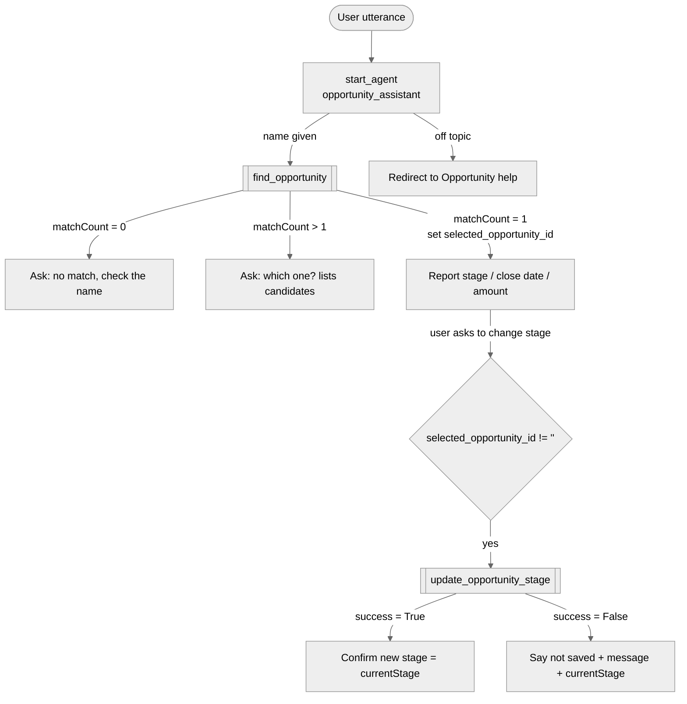

# Agent Spec: Opportunity_Assistant

Status: **APPROVED 2026-10-18 (checkpoint b)**: design as written, generate Apex + tests, create `Opportunity_Assistant_Access`. Nothing has been built yet.
Written 2026-10-18 following the `agentforce-generate` skill's Agent Spec template.

## Purpose & Scope

An internal assistant that helps sales users look up an Opportunity by name and move it to a new stage, from Lightning Experience.
It exists so that Agent Interceptor has a real, record-changing agent action to verify. It is deliberately small: two actions, one execution block.

**In scope:** finding one Opportunity by name; reporting its stage, close date and amount; changing its stage.
**Out of scope:** creating or deleting Opportunities, editing any other field, other objects, forecasting, and anything not about Opportunities (redirect politely).

## Behavioral Intent

- **Find before update.** The agent always identifies the Opportunity with `find_opportunity` before changing it. `update_opportunity_stage` only accepts the ID that `find_opportunity` returned for a single match (enforced at runtime, see Deterministic Controls), so the model cannot guess or invent an ID.
- **Ambiguity.** If the name matches no records or several, the agent asks one clarifying question (for several, it lists the candidates `find_opportunity` returned) and does not update anything.
- **Valid stage.** The Apex action checks the requested stage against the org's active `OpportunityStage` values. If it isn't valid, the action returns `success = false` with the list of valid stages, and the agent asks the user to pick one. The model is not trusted to judge picklist validity.
- **Honest reporting (non-negotiable).** After an update the agent reports **only what the action returned**: on `success = True` it confirms the new stage using `currentStage`. On `success = False` it says the change was not saved, gives the `message` text, and states `currentStage`. The action catches every save error (validation rule, permission, record lock, etc.) and returns it as `success = false`. **Nothing is built to make the agent claim success falsely.** Whatever the agent actually says when a validation rule blocks the save is recorded in `docs/VERIFICATION_LOG.md` and is what Agent Interceptor classifies.
- **Implementation type:** invocable Apex for both actions.
- **Conversational facts in history (no variable needed):** the name the user typed, the requested stage, and the candidate list from an ambiguous search.
- **Interaction style:** concise, factual, business tone. Use the exact stage names and values from action outputs; no paraphrasing of amounts or dates.

## Subagent Posture

| Subagent | Posture | Why this posture? | Deterministic controls |
|---|---|---|---|
| `start_agent opportunity_assistant` | agentic (mixed) | One objective and two actions; the model handles intent, clarification and wording | `update_opportunity_stage` only available after a single-match find, and its ID input is bound to that find's output |

## Subagent Map

No other subagents. Greeting, clarification, refusal and completion are branches inside the single block, as the skill recommends.

## Variables

| Variable | Type / Default | Trusted Writer | Named Consumer | Cause | Reset / Expiry / Correction / Cancel |
|---|---|---|---|---|---|
| `selected_opportunity_id` | `mutable string = ""` | `find_opportunity` output `opportunityId` (set on every call) | `update_opportunity_stage` input `opportunityId` and its `available when` gate | exact action-to-action data flow + "find before update" ordering | Overwritten by every `find_opportunity` call. The Apex returns `""` unless exactly one record matched, so a new zero- or multi-match search clears it. |

Nothing else is stored. History carries the rest.

## Actions

### find_opportunity (start_agent)

- **Target:** `apex://OpportunityAssistantFind` (proposed)
- **Status:** NEEDS CREATION (approved: generate invocable Apex + tests)
- **Read-only.**

#### Inputs

| Name | Type | Required | Source |
|---|---|---|---|
| `opportunityName` | string | Yes | User input (slot-filled) |

#### Outputs

| Name | Type | Visible to User? | Source | Notes |
|---|---|---|---|---|
| `matchCount` | integer | Yes | Computed | 0, 1, or the number of candidates (capped at 5) |
| `opportunityId` | string | No | `Opportunity.Id` | Set only when `matchCount = 1`, otherwise `""`. Hidden from the model (`filter_from_agent: True`) because it's consumed by the variable, not shown. |
| `opportunityName` | string | Yes | `Opportunity.Name` | single match only |
| `stageName` | string | Yes | `Opportunity.StageName` | single match only |
| `closeDate` | date | Yes | `Opportunity.CloseDate` | single match only |
| `amount` | number | Yes | `Opportunity.Amount` | single match only; may be empty |
| `candidates` | string | Yes | Computed | When 2–5 match: one line per record, "Name (Stage, close YYYY-MM-DD)". Empty otherwise. |
| `message` | string | Yes | Computed | Short plain-language summary, for example "No opportunity named X was found." |

#### Matching logic

1. Exact name match (case-insensitive, SOQL `=`). If exactly one, return it.
2. Otherwise a contains match (`LIKE '%name%'`), `LIMIT 6` to detect "more than 5".
3. Queries run `WITH USER_MODE`, so they respect the running user's sharing and field access. **Known risk:** missing object or field access returns zero rows silently. The live preview tests cover this.

### update_opportunity_stage (start_agent)

- **Target:** `apex://OpportunityAssistantUpdateStage` (proposed)
- **Status:** NEEDS CREATION (approved: generate invocable Apex + tests)
- **Changes data:** the `StageName` of one Opportunity.

#### Inputs

| Name | Type | Required | Source |
|---|---|---|---|
| `opportunityId` | string | Yes | **Bound to `@variables.selected_opportunity_id`** (not slot-filled) |
| `newStage` | string | Yes | User input (slot-filled) |

#### Outputs

| Name | Type | Visible to User? | Source | Notes |
|---|---|---|---|---|
| `success` | boolean | Yes | Computed | `True` only if the save succeeded **and** a re-query shows `StageName = newStage` |
| `message` | string | Yes | Computed | On failure: the save error text (for example the validation rule's error message), "Stage X isn't valid. Valid stages: …", or "Opportunity not found or not accessible." On success: "Stage changed from A to B." |
| `currentStage` | string | Yes | `Opportunity.StageName` re-queried after the attempt | What the record actually holds now |
| `previousStage` | string | Yes | `Opportunity.StageName` before the attempt | |

#### Save logic

1. Load the record `WITH USER_MODE`. If it's missing, return `success=false`.
2. Compare `newStage` with active `OpportunityStage.ApiName` values (case-insensitive, normalised to the exact API name). If there's no match, return `success=false` with the valid list. No DML.
3. If the record is already in that stage, return `success=true` with "already in stage X". No DML.
4. Run `Database.update(record, false, AccessLevel.USER_MODE)`, then collect `SaveResult.getErrors()` messages into `message`.
5. Re-query `StageName` into `currentStage`. Set `success` from the save result **and** this re-query.

### Apex quality (both classes)

- One `@InvocableMethod` per class, inner `Request`/`Result` classes with multiline `@InvocableVariable` annotations (skill template `assets/invocable-apex-template.cls`).
- Bulk-safe: no SOQL or DML in loops. `find` uses one query with `LIKE :patternList`; `update` uses one load, one `Database.update`, one re-query.
- `with sharing` + `WITH USER_MODE` / `AccessLevel.USER_MODE`.
- Unit tests aiming for **≥ 85% coverage** per class: exact match; several matches; no match; >5 matches; update success; invalid stage; already in stage; record not found; **save error** (real DML failure caused by updating a record deleted within the test, with no test-only backdoor in the production code).

> **Naming (build note, 2026-10-18):** Action input/output names are camelCase because Agent Script requires them to match the Apex `@InvocableVariable` names exactly. Action names stay snake_case.

## Action Invocation Strategy

| Action | Invocation Mode | Why |
|---|---|---|
| `find_opportunity` | Planner slot-fill (`with opportunityName = ...`), `set @variables.selected_opportunity_id = @outputs.opportunity_id` | The user's intent decides when to search |
| `update_opportunity_stage` | Planner slot-fill for `newStage`; `opportunityId` bound to the variable; `available when @variables.selected_opportunity_id != ""` | The user decides when to change; the runtime guarantees a found, single record |

Loop prevention: post-action instructions name the exact output fields to report and say "do not call the action again for the same request". The variable-bound ID is safe because `newStage` still has to come from the user's latest request.

## Deterministic Controls

- `update_opportunity_stage` visibility: `available when @variables.selected_opportunity_id != ""`. **Cause:** external ordering ("find before update") and protection against a model-invented record ID. **Trusted writer:** `find_opportunity` output. **Protected outcome:** only the record the user actually found can be changed.

## Architecture Pattern

One execution block, `start_agent opportunity_assistant`, with zero `subagent` blocks and no router. No escalation: `@utils.escalate` is for service agents only.

## Agent Configuration

- **developer_name:** `Opportunity_Assistant`
- **agent_label:** `Opportunity Assistant`
- **agent_type:** `AgentforceEmployeeAgent` (internal sales users in Lightning Experience)
- **access.default_agent_user:** omitted. The skill says that setting it on an employee agent makes preview and publish fail. Employee agents run as the **logged-in user**.
- **Bundle:** `force-app/main/default/aiAuthoringBundles/Opportunity_Assistant/Opportunity_Assistant.agent` + `Opportunity_Assistant.bundle-meta.xml`, generated with `sf agent generate authoring-bundle`.
- **API version:** org 68.0, project `sourceApiVersion` 67.0. The skill requires v66.0+.
- **Lifecycle:** draft only. Preview with `--simulate-actions`, then `--use-live-actions`. No publish or activate unless Agent Interceptor needs it, and then only after asking.

## Org facts this design relies on (checked 2026-10-18)

- Active stages (`OpportunityStage`, sort order): Prospecting, Qualification, Needs Analysis, Value Proposition, Id. Decision Makers, Perception Analysis, Proposal/Price Quote, Negotiation/Review, Closed Won, Closed Lost.
- Opportunity validation rules: **none**. Record types: **none**. Existing Opportunities: **0**. Every preview record will be an `AI-Test-<runId>` record we create and delete.

## Permissions

- Preview and live actions run as you, `YOUR_ADMIN_USERNAME` (System Administrator), because this is an employee agent. That means live actions will **not** show what a less-privileged sales user would hit. The LLD will state this.
- Proposed permission set `Opportunity_Assistant_Access`: Apex class access to both classes + `agentAccesses` for the agent (needed for Lightning panel visibility only after publish). Approved; to be deployed together with the Apex classes, after asking before the deploy.

## Preview plan (checkpoint c)

Simulated first, then live (after asking), on `AI-Test-<runId>` records:

| # | Case | Setup | Utterance (example) | Expected org outcome |
|---|---|---|---|---|
| 1 | Happy path | 1 opp in Prospecting | "Move AI-Test-<runId> to Qualification" | StageName = Qualification |
| 2 | Not found | none | "What stage is AI-Test-missing-<runId> in?" | no change, clarifying question |
| 3 | Ambiguous | 2 opps `AI-Test-<runId>-A/-B` | "Update AI-Test-<runId> to Closed Won" | no change, asks which |
| 4 | Invalid stage | 1 opp | "Move AI-Test-<runId> to Signed" | no change, offers valid stages |
| 5 | Blocked save | 1 opp + temporary validation rule (deployed only after asking, removed afterwards) | "Move AI-Test-<runId> to Closed Won" | no change. **Record the agent's exact reply.** |

For each case: exact replies, the trace (`sf agent trace read --format detail --dimension actions`), and record state before and after go into `docs/VERIFICATION_LOG.md`. That uses 5 conversations, within the 10-per-run cap.

## Decisions (2026-10-18)

1. **Design approved as written**, including the variable. Especially the one variable `selected_opportunity_id` (gate + bound ID). The brief allows a variable only "if a named deterministic consumer needs one". Its consumers are the update action's input and `available when` gate. The alternative is no variable, with the model passing the ID from history, which is less safe and makes `WRONG_ACTION` harder to rule out.
2. **Action implementations: generate both invocable Apex classes with tests** (approved). The alternative is to leave `NEEDS STUB` placeholders and simulate only. The org has no existing Opportunity actions to reuse.
3. **Permission set `Opportunity_Assistant_Access`: create** (approved).
